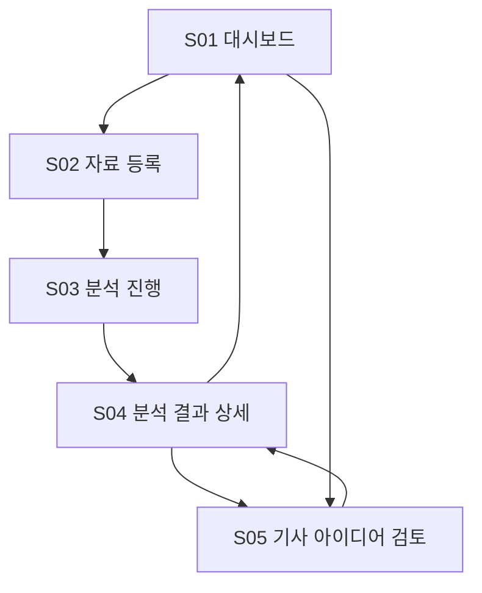
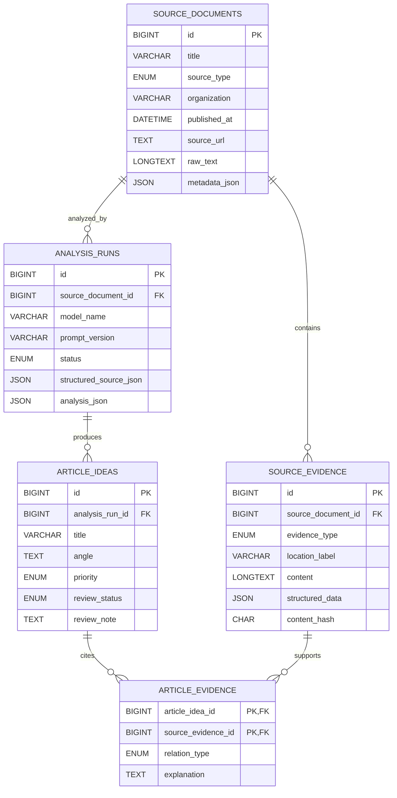

# RGF — Reporting Gap Finder

정책자료에서 기자가 추가 취재할 만한 기사거리를 찾고, 각 아이디어를 원문 근거와 취재 질문에 연결하는 기자용 웹 앱입니다.

## 목차

1. [프로젝트 소개](#1-프로젝트-소개)
2. [기능정의서](#2-기능정의서)
3. [화면구성도](#3-화면구성도)
4. [DB 설계](#4-db-설계)
5. [데이터 수집 방법](#5-데이터-수집-방법)
6. [개발 환경](#6-개발-환경)
7. [실행 방법](#7-실행-방법)
8. [테스트 항목](#8-테스트-항목)

---

## 1. 프로젝트 소개

### 주제

정부 보도자료와 정책자료집 PDF를 입력받아 자료의 핵심 주장, 정책 변화, 빠진 정보와 추가 취재 지점을 분석하고, 기자가 검토할 수 있는 기사 아이디어로 정리합니다.

### 주요 독자

- 정부 정책과 공공자료를 취재하는 기자
- 다량의 보도자료를 빠르게 검토해야 하는 편집자·인턴 기자

### 핵심 목표

- 정책자료를 단순히 요약하지 않고 추가 취재가 필요한 지점을 찾습니다.
- 기사 아이디어가 어떤 원문 페이지·문단을 근거로 하는지 추적할 수 있게 합니다.
- AI가 만든 결과를 기자가 `검토대기`, `승인`, `보류` 상태로 관리하게 합니다.
- 기사 초안을 자동 작성하기보다 기사거리, 취재 질문, 필요한 추가 근거를 제시합니다.

### MVP 범위

- 개인용 로컬 웹 앱
- 정책자료집 PDF 업로드
- 정부 보도자료·정책자료 텍스트 직접 입력
- 핵심 주장·수치·정책 변화·정보 공백 추출
- 기사 아이디어·취재 질문·필요 근거 생성
- 기사 아이디어와 원문 근거 연결
- 기자 검토 상태와 메모 저장

CSV, Open API, URL 자동수집, 기사 초안 자동 작성, 로그인, 배포 자동화는 MVP에서 제외하고 확장 후보로 둡니다.

### 전체 흐름


### 화면 이미지 자리

> 구현 후 대시보드 및 분석 결과 화면 이미지를 추가할 예정입니다.

---

## 2. 기능정의서

| ID | 기능명 | 설명 | 입력 → 출력 |
|---|---|---|---|
| F01 | 텍스트 직접 입력 | 보도자료 또는 정책자료 본문을 직접 입력합니다. | 텍스트 → 원문 자료 레코드 |
| F02 | PDF 업로드 | 정책자료집 PDF를 업로드하고 페이지별 텍스트를 추출합니다. | PDF → 파일 정보·페이지별 텍스트 |
| F03 | 자료 메타데이터 관리 | 자료 제목, 발표 기관, 발표일, 자료 유형을 저장하고 보정합니다. | 추출값·사용자 입력 → 자료 메타데이터 |
| F04 | 자료 전처리 | 원문을 페이지·문단 단위로 나누고 위치 정보를 붙입니다. | 원문 → 분석용 텍스트 블록 |
| F05 | 자료 구조화 | 핵심 주장, 수치, 정책 변화, 시행 시점과 출처 위치를 추출합니다. | 분석용 텍스트 → 구조화 분석 JSON |
| F06 | 정보 공백 탐지 | 기준점, 분모, 정의, 기간, 근거, 당사자 관점의 누락을 찾습니다. | 구조화 자료 → 정보 공백 목록 |
| F07 | 기사거리 생성 | 중요 변화와 정보 공백을 기사 아이디어와 취재 질문으로 만듭니다. | 구조화 자료·정보 공백 → 기사 아이디어 목록 |
| F08 | 근거 연결 | 각 기사 아이디어를 원문 페이지·문단과 연결합니다. | 기사 아이디어·원문 구간 → 기사–근거 연결 |
| F09 | 분석 결과 조회 | 자료 개요, 핵심 주장, 정보 공백, 기사 아이디어와 근거를 표시합니다. | 자료 ID → 분석 결과 화면 |
| F10 | 검토 상태 관리 | 기사 아이디어를 검토대기·승인·보류로 변경하고 메모를 저장합니다. | 상태·메모 → 갱신된 기사 아이디어 |
| F11 | 결과 내보내기 | 기사 아이디어와 근거를 JSON으로 내려받습니다. | 분석 결과 → JSON 파일 |

### 기사 아이디어 출력 항목

- 기사 가제
- 핵심 기사거리
- 왜 중요한가
- 자료가 직접 말하는 내용
- 자료만으로 알 수 없는 내용
- 취재 질문
- 추가로 확보해야 할 증거·데이터
- 인터뷰·취재 대상
- 연결된 원문 근거
- 우선순위
- 검토 상태

---

## 3. 화면구성도

### S01. 대시보드

| 구성 요소 | 설명 |
|---|---|
| 새 자료 분석 | 자료 등록 화면으로 이동 |
| 최근 자료 목록 | 제목, 기관, 자료 유형, 등록일, 분석 상태 표시 |
| 기사 아이디어 현황 | 검토대기·승인·보류 건수 표시 |
| 검색·필터 | 기관, 등록일, 분석 상태로 자료 검색 |

### S02. 자료 등록

| 구성 요소 | 설명 |
|---|---|
| 입력 방식 | PDF 또는 텍스트 직접 입력 선택 |
| PDF 업로드 | 정책자료집 PDF 선택 |
| 텍스트 입력 | 보도자료·정책자료 본문 붙여넣기 |
| 메타데이터 | 제목, 기관, 발표일 자동 추출 후 사용자 보정 |
| 분석 시작 | 자료 저장 후 분석 실행 |

### S03. 분석 진행

| 구성 요소 | 설명 |
|---|---|
| 단계 표시 | 입력 처리 → 자료 구조화 → 기사거리 생성 → 근거 연결 → 저장 |
| 상태 표시 | 대기, 진행 중, 완료, 실패 |
| 오류 안내 | PDF 추출 실패, OpenAI 오류 등을 한국어로 표시 |
| 결과 보기 | 분석 완료 후 상세 화면으로 이동 |

### S04. 분석 결과 상세

| 구성 요소 | 설명 |
|---|---|
| 자료 개요 | 제목, 기관, 발표일, 입력 형식 |
| 핵심 주장·수치 | 자료가 제시한 주장과 내부 근거 |
| 정책 변화 | 이전 상태, 이후 상태, 시행 시점 |
| 정보 공백 | 기준점·분모·정의·기간·근거·관점의 누락 |
| 기사 아이디어 | 가제, 중요성, 취재 질문, 취재 대상, 필요한 근거 |
| 원문 근거 | 연결된 페이지·문단 미리보기 |
| 검토 상태 | 승인·보류·검토대기 변경 |
| 내보내기 | JSON 다운로드 |

### S05. 기사 아이디어 검토

| 구성 요소 | 설명 |
|---|---|
| 아이디어 목록 | 상태·우선순위·기관·등록일 기준 정렬 |
| 아이디어 상세 | 기사거리, 취재 질문, 필요한 근거 표시 |
| 근거 확인 | 해당 아이디어가 참조한 원문 구간 표시 |
| 상태 변경 | 검토대기·승인·보류 선택 |
| 기자 메모 | 판단 이유와 후속 취재 계획 입력 |

### 화면 이동 순서



---

## 4. DB 설계

### 설계 원칙

- 테이블은 5개로 제한합니다.
- 원문 자료와 원문 근거 구간을 분리합니다.
- 같은 자료를 다시 분석해도 실행 결과를 구분할 수 있게 합니다.
- 기사 아이디어와 근거를 다대다 관계로 연결합니다.
- 상태 관리에 필요한 값은 일반 컬럼으로, AI 상세 결과는 JSON 컬럼으로 저장합니다.

### `source_documents` — 원문 자료

| 컬럼 | 타입 | 키 | Null | 설명·제약조건 |
|---|---|---|---|---|
| `id` | BIGINT | PK | N | AUTO_INCREMENT |
| `title` | VARCHAR(500) |  | N | 자료 제목 |
| `source_type` | ENUM |  | N | `PDF`, `TEXT` |
| `organization` | VARCHAR(255) |  | Y | 발표 기관 |
| `published_at` | DATETIME |  | Y | 발표 시점 |
| `source_url` | TEXT |  | Y | 원문 주소 |
| `file_path` | TEXT |  | Y | 업로드 PDF 저장 경로 |
| `raw_text` | LONGTEXT |  | Y | 입력·추출한 원문 텍스트 |
| `metadata_json` | JSON |  | Y | 파일 정보 등 부가정보 |
| `created_at` | DATETIME |  | N | 기본값 CURRENT_TIMESTAMP |

애플리케이션에서 `file_path`와 `raw_text` 중 최소 하나가 존재하도록 검사합니다.

### `source_evidence` — 원문 근거 구간

| 컬럼 | 타입 | 키 | Null | 설명·제약조건 |
|---|---|---|---|---|
| `id` | BIGINT | PK | N | AUTO_INCREMENT |
| `source_document_id` | BIGINT | FK | N | `source_documents.id`, 삭제 시 CASCADE |
| `evidence_type` | ENUM |  | N | `PAGE_TEXT`, `PARAGRAPH`, `TABLE` |
| `location_label` | VARCHAR(255) |  | Y | 예: `PDF 7쪽`, `3번째 문단` |
| `content` | LONGTEXT |  | N | 실제 원문 근거 |
| `structured_data` | JSON |  | Y | 표 등 구조화 값 |
| `content_hash` | CHAR(64) |  | Y | 중복 감지용 SHA-256 |
| `created_at` | DATETIME |  | N | 기본값 CURRENT_TIMESTAMP |

### `analysis_runs` — AI 분석 실행

| 컬럼 | 타입 | 키 | Null | 설명·제약조건 |
|---|---|---|---|---|
| `id` | BIGINT | PK | N | AUTO_INCREMENT |
| `source_document_id` | BIGINT | FK | N | `source_documents.id`, 삭제 시 CASCADE |
| `model_name` | VARCHAR(100) |  | N | 실제 사용한 모델명 |
| `prompt_version` | VARCHAR(50) |  | N | 프롬프트 버전 |
| `status` | ENUM |  | N | `PENDING`, `RUNNING`, `COMPLETED`, `FAILED` |
| `structured_source_json` | JSON |  | Y | 자료 구조화 결과 |
| `analysis_json` | JSON |  | Y | 전체 기사거리 분석 결과 |
| `error_message` | TEXT |  | Y | 실패 원인 |
| `started_at` | DATETIME |  | Y | 분석 시작 시각 |
| `completed_at` | DATETIME |  | Y | 분석 종료 시각 |
| `created_at` | DATETIME |  | N | 기본값 CURRENT_TIMESTAMP |

### `article_ideas` — 기사 아이디어

| 컬럼 | 타입 | 키 | Null | 설명·제약조건 |
|---|---|---|---|---|
| `id` | BIGINT | PK | N | AUTO_INCREMENT |
| `analysis_run_id` | BIGINT | FK | N | `analysis_runs.id`, 삭제 시 CASCADE |
| `title` | VARCHAR(500) |  | N | 기사 가제 |
| `angle` | TEXT |  | N | 핵심 기사거리 |
| `why_it_matters` | TEXT |  | N | 취재 가치 |
| `reporting_questions` | JSON |  | N | 취재 질문 배열 |
| `evidence_needed` | JSON |  | N | 추가 확보 자료 배열 |
| `reporting_targets` | JSON |  | Y | 취재 대상 배열 |
| `priority` | ENUM |  | N | `HIGH`, `MEDIUM`, `LOW` |
| `review_status` | ENUM |  | N | `검토대기`, `승인`, `보류`; 기본값 `검토대기` |
| `review_note` | TEXT |  | Y | 기자 메모 |
| `created_at` | DATETIME |  | N | 기본값 CURRENT_TIMESTAMP |
| `updated_at` | DATETIME |  | N | 수정 시 자동 갱신 |

### `article_evidence` — 기사와 근거 연결

| 컬럼 | 타입 | 키 | Null | 설명·제약조건 |
|---|---|---|---|---|
| `article_idea_id` | BIGINT | PK, FK | N | `article_ideas.id`, 삭제 시 CASCADE |
| `source_evidence_id` | BIGINT | PK, FK | N | `source_evidence.id`, 삭제 시 CASCADE |
| `relation_type` | ENUM |  | N | `SUPPORTS`, `CONTEXT`, `GAP_TRIGGER` |
| `explanation` | TEXT |  | N | 기사 아이디어와 연결되는 이유 |
| `created_at` | DATETIME |  | N | 기본값 CURRENT_TIMESTAMP |

복합 PK는 `(article_idea_id, source_evidence_id)`입니다.

### ERD



---

## 5. 데이터 수집 방법

### MVP 입력

| 출처 | 수집 값 | 형식 | 수집 방식 | 주의점 |
|---|---|---|---|---|
| 정책자료집 | 제목, 기관, 발표일, 본문, 표, 페이지 | PDF | 사용자 파일 업로드 | MVP는 텍스트 추출 가능한 PDF를 우선 지원 |
| 정부 보도자료 | 제목, 기관, 발표일, 본문, 원문 URL | TEXT | 사용자가 본문 직접 입력 | 원문 URL과 자료명을 함께 기록 |

### 공통 정규화 값

| 값 | 설명 |
|---|---|
| `title` | 자료 제목 |
| `organization` | 발표 기관 |
| `published_at` | 발표 시점 |
| `source_type` | PDF 또는 TEXT |
| `source_url` | 원자료 주소 |
| `content_blocks` | 페이지·문단별 내용 |
| `location_label` | 원문 위치 표시 |
| `metadata` | 파일 정보 등 부가정보 |

### v0.2 확장 후보

- CSV 업로드
- 구체적인 취재 목적에 맞는 공공데이터 Open API
- 대상 정부 사이트의 보도자료 URL 자동수집

Open API는 API마다 인증, 필드명, 단위와 오류 형식이 다르므로 핵심 분석과 근거 연결 기능을 먼저 검증한 뒤 필요한 API 하나씩 추가합니다.

---

## 6. 개발 환경

### 기술 스택

| 구분 | 기준 | 용도 |
|---|---|---|
| Python | 3.11.x | 백엔드 언어 |
| FastAPI | 0.115 이상, 1.0 미만 | 웹 API·서버 화면 |
| Uvicorn | 0.34 이상 | 개발 서버 |
| MySQL | 8.4 LTS | 데이터베이스 |
| SQLAlchemy | 2.0.x | ORM |
| Alembic | 1.14 이상 | DB migration |
| Pydantic | 2.x | 입력·응답·AI JSON 검증 |
| OpenAI Python SDK | 2.x 호환 최신 버전 | Responses API 호출 |
| PyMySQL | 1.1.x | MySQL 연결 |
| HTTPX | 0.28.x | 외부 요청 |
| pypdf | 5.x 이상 | PDF 텍스트 추출 |
| python-multipart | 0.0.20 이상 | 파일 업로드 |
| Jinja2 | 3.1.x | HTML 화면 |
| pytest | 8.x 이상 | 자동 테스트 |
| VS Code | 최신 안정 버전 | 개발 도구 |

구현 시작 시 서로 호환되는 최신 patch 버전을 고정합니다. 별도 프런트엔드 프레임워크는 MVP에서 사용하지 않습니다.

### OpenAI API

- 기본 모델: `gpt-5-mini`
- 모델명은 `.env`의 `OPENAI_MODEL`로 관리합니다.
- 직접 모델 요청에는 Responses API를 사용합니다.
- 기사 아이디어는 JSON Schema 기반 Structured Outputs로 받습니다.
- AI 결과의 ID와 원문 근거 연결은 서버에서 다시 검사한 후 저장합니다.
- API 사용료는 ChatGPT 구독과 별도일 수 있습니다.

### `.env` 변수

```dotenv
APP_ENV=
APP_SECRET_KEY=

MYSQL_HOST=
MYSQL_PORT=
MYSQL_DATABASE=
MYSQL_USER=
MYSQL_PASSWORD=

OPENAI_API_KEY=
OPENAI_MODEL=gpt-5-mini

UPLOAD_DIR=
MAX_UPLOAD_MB=
```

`.env`는 Git에 올리지 않습니다. 저장소에는 실제 값이 없는 `.env.example`만 둡니다.

---

## 7. 실행 방법

작성 예정

---

## 8. 테스트 항목

작성 예정
