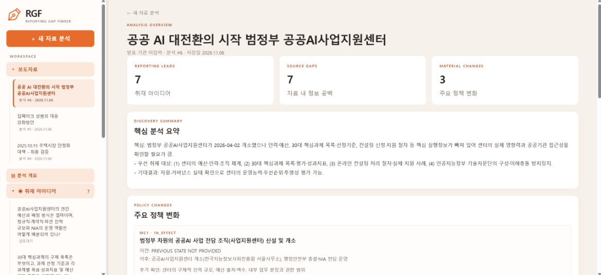
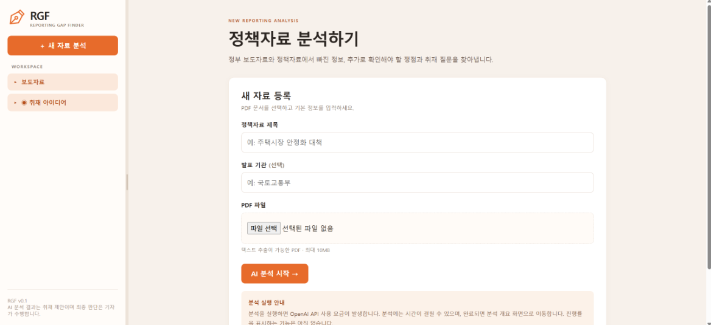
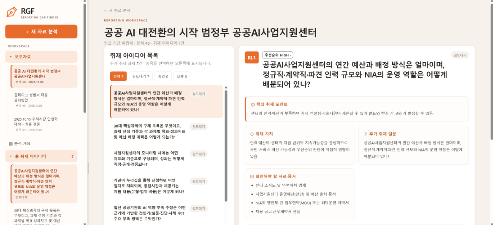

# RGF — Reporting Gap Finder

**정책자료의 빈틈에서 취재의 출발점을 찾다.**

RGF는 정부 보도자료·정책자료 PDF를 AI로 분석해 **정책 변화, 자료 안의 정보 공백, 추가 취재할 질문**을 찾는 기자용 웹앱입니다. 정책자료를 요약하는 데 그치지 않고, 왜 취재할 가치가 있는지와 어떤 자료를 더 확인해야 하는지 제안합니다. **AI의 분석은 취재 제안이지 검증된 기사나 사실 판정이 아닙니다.**

> **개발 단계:** v0.1 프로토타입 · Railway 배포 및 디버깅 진행 중 (2026-11-06 기준). 현재 배포 URL과 실사용 가능 여부는 별도 확인이 필요합니다.



## RGF가 하는 일

| 단계 | 주요 기능 | 사용자에게 주는 가치 |
|---|---|---|
| **1. 자료 입력** | 정책자료 PDF 업로드, 제목·발표 기관 입력 | 분석할 원문 등록 |
| **2. 정책 분석** | 핵심 주장·정책 변화·정보 공백 추출 | 발표 내용뿐 아니라 빠진 정보를 찾음 |
| **3. 취재 아이디어** | 우선순위 등급(HIGH 등), 질문·취재 가치·필요한 증거 제시 | 무엇을 먼저 확인할지 판단 지원 |
| **4. 근거 확인** | 가능한 원문 구간 연결 및 검토 안내 | AI 분석과 원문을 비교하도록 지원 |
| **5. 기자 검토** | 아이디어 검토대기·승인·보류 및 메모 | 최종 판단을 사람이 유지 |

### 1. PDF 정책자료 등록



텍스트 추출이 가능한 PDF를 업로드해 분석합니다. 현재 화면에서 제목과 발표 기관을 입력할 수 있으며, 분석 실행 시 OpenAI API 사용료가 발생할 수 있습니다.

### 2. 정책 변화와 정보 공백 파악


자료별 취재 아이디어·정보 공백·주요 정책 변화의 건수와 핵심 요약을 살펴볼 수 있습니다. **이 수치는 AI 분석 결과의 개수이지 정확도 점수가 아닙니다.**

### 3. 취재 아이디어 검토



아이디어별 추천 우선순위, 핵심 취재 포인트, 취재 가치, 추가 취재 질문, 필요한 자료·증거를 제공합니다. 현재 UI는 HIGH 등 우선순위를 표시하지만, 순위가 사실 정확성을 의미하지는 않습니다. 화면 아래쪽에는 원문 근거 확인과 기자 검토 기능이 있습니다(위 캡처에는 해당 영역이 보이지 않습니다).

## 작동 흐름


### AI 분석과 검증의 경계

- **원문에서 확인되는 내용:** 문서 자체의 주장·수치·정책 조치. 문서에 적혀 있다고 외부적으로 사실 검증된 것은 아닙니다.
- **AI가 제안하는 내용:** 정보 공백, 취재 가치, 취재 질문, 추가 확보할 자료.
- **아직 확인되지 않은 내용:** 원문이 답하지 않는 질문과 외부 취재가 필요한 사실.
- **근거 연결:** 원문 텍스트와의 일치 여부 및 참조 관계를 검사하는 기능이 있지만, 연결된 인용이 기사 아이디어를 실질적으로 뒷받침한다는 의미적 검증까지 완료된 것은 아닙니다.

## 기술 스택

| 영역 | 기술 |
|---|---|
| 웹·서버 | Python, FastAPI, Jinja2 |
| AI | OpenAI API, Pydantic/JSON Schema |
| PDF | pypdf |
| 데이터 저장 | MySQL(로컬), PostgreSQL 대응 코드 및 DDL(Railway 배포용) |
| 배포 | Railway 배포·디버깅 진행 중 |
| 테스트 | pytest |

데이터베이스는 원문 자료, 분석 실행, 취재 아이디어, 연결 근거, 기자 검토 상태를 보존합니다. MySQL 설계는 `db/schema.sql`, PostgreSQL 설계는 `db/schema_postgresql.sql`을 참고하세요.

## 로컬 실행

Python 가상환경과 환경변수(`OPENAI_API_KEY` 및 DB 연결 정보)를 먼저 설정합니다. 자세한 환경변수는 `.env.example`을 참고하세요. `.env`에 실제 비밀값을 넣고 Git에 올리지 마세요.

```powershell
python -m pip install -r requirements.txt
python -m uvicorn app.web:app --reload --host 127.0.0.1 --port 8000
```

브라우저에서 `http://127.0.0.1:8000`에 접속합니다. 실제 DB 스키마가 준비되어 있어야 하며, OpenAI 분석에는 API 키와 별도 사용 요금이 필요합니다.

## 구현 현황 및 한계

- **코드에서 확인:** PDF 업로드, AI 분석 파이프라인, 저장된 분석 개요, 취재 아이디어 조회·관리, 기자 검토, 원문 근거 연결 기능.
- **실사용·배포 구분:** 과거 로컬 웹 분석 및 DB 저장 사례가 있으나, 최신 Railway 배포의 모든 기능이 정상 작동하는지는 별도 확인이 필요합니다.
- **품질 한계:** AI가 제시하는 페이지·근거와 실제 원문이 불일치하는 사례가 확인됐으며, 근거의 의미적 타당성을 전수 검증하는 기능은 완성되지 않았습니다. 스캔 PDF OCR 및 텍스트 직접 입력 UI는 현재 범위에 포함되지 않습니다.
- **우선순위:** 우선순위 등급 표시 기능은 있으나 추천 기준과 정확도의 시각적 구분, 개요 화면에서의 추천순위 강조는 개선 대상입니다.

## 다음 단계

현재는 **Railway 프로토타입의 배포·디버깅 완료**가 먼저입니다. 이후 분석 신뢰도 및 우선순위 가시성, 가독성, 정책 발표 전후 관련기사 현황(특히 발표 이전 선행 보도와 기존 취재 쟁점 비교)을 검토할 예정입니다. 아직 구현 확정된 기능은 아닙니다.

- [GitHub 후속 개선 백로그 — Issue #1](https://github.com/csy04x2/RGF/issues/1)
- 상세 설계·방법론: [`docs/architecture.md`](docs/architecture.md) · [`docs/methodology.md`](docs/methodology.md)
- AI 결과 구조: [`schemas/`](schemas/) · 과거 Opal 자산: [`docs/legacy-opal/`](docs/legacy-opal/)

---

**RGF의 목표는 기자를 대신해 기사를 쓰는 것이 아니라, 기자가 놓칠 수 있는 질문을 더 빨리 찾도록 돕는 것입니다.**
