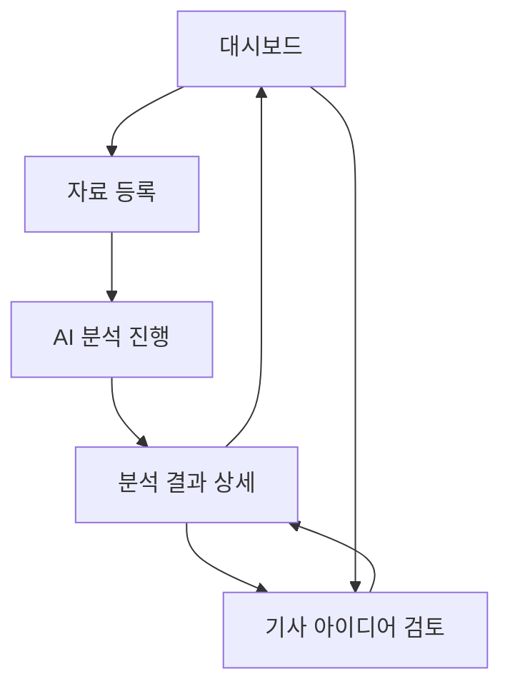
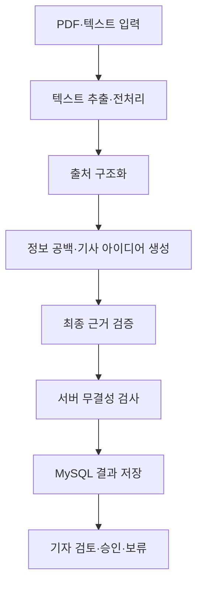
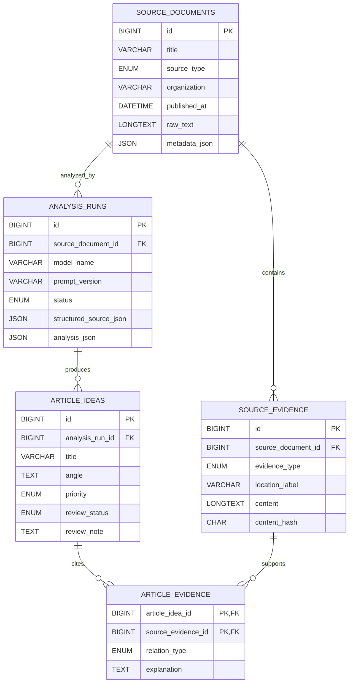

# RGF — Reporting Gap Finder

RGF는 정부 보도자료와 정책자료를 AI로 분석해, 단순 요약을 넘어 기자가 추가 취재해야 할 정보 공백과 기사 아이디어를 발굴하는 데이터 저널리즘 도구입니다. 기사 아이디어가 원문의 어느 대목에서 출발했는지 추적하고, AI가 생성한 분석을 기자가 직접 검토·승인·보류할 수 있게 하는 것이 핵심입니다.

## 목차

1. [프로젝트 소개](#1-프로젝트-소개)
2. [핵심 기능 정의서](#2-핵심-기능-정의서)
3. [화면구성도](#3-화면구성도)
4. [시스템 아키텍처 및 AI 분석 흐름](#4-시스템-아키텍처-및-ai-분석-흐름)
5. [DB 설계](#5-db-설계)
6. [데이터 입력 및 처리 방법](#6-데이터-입력-및-처리-방법)
7. [AI 분석 및 검증 설계](#7-ai-분석-및-검증-설계)
8. [개발 환경](#8-개발-환경)
9. [실행 방법](#9-실행-방법)
10. [테스트 및 품질 검증](#10-테스트-및-품질-검증)

---

## 1. 프로젝트 소개

### 기획 배경과 해결하려는 문제

정부 보도자료와 정책자료는 발표 주체의 관점에서 작성되므로 핵심 수치와 정책 변화는 담고 있어도 비교 기준, 분모, 정의, 시행 조건, 영향을 받는 집단의 관점 등이 빠질 수 있습니다. 기자가 이를 매번 수작업으로 읽고 검증 지점을 찾는 데에는 많은 시간이 듭니다.

RGF는 자료의 내용을 먼저 구조화한 뒤, 자료 안에서 확인되는 사실과 아직 확인되지 않은 부분을 구분합니다. 이후 추가 취재 가치가 있는 정보 공백을 기사 아이디어, 취재 질문, 필요한 증거와 연결해 기자의 판단을 돕습니다. AI의 결과는 완성된 기사나 확정된 사실이 아니라 취재를 시작하기 위한 보조 자료입니다.

### 주요 사용자 및 활용 사례

- 정부 정책과 공공자료를 취재하는 기자
- 많은 보도자료를 빠르게 검토해야 하는 편집자·인턴 기자
- 정책 발표의 전후 변화, 수치 근거, 시행 조건을 확인하려는 데이터 저널리스트
- AI가 제안한 기사 아이디어를 원문 근거와 대조하고 승인 또는 보류하려는 사용자

### v0.1 개발 범위

| 구분 | v0.1 범위 | 현재 상태 |
|---|---|---|
| 입력 | 텍스트 추출 가능한 PDF 업로드 | CLI에서 구현됨 |
| 입력 | 정부 보도자료·정책자료 텍스트 직접 입력 | 설계됨, 작성 예정 |
| 분석 | 자료 구조화, 정보 공백 탐지, 기사 아이디어·취재 질문 생성 | CLI 핵심 파이프라인 구현됨 |
| 검증 | JSON Schema 기반 출력 검증, ID·관계·렌더링 보존 검사 | 구현됨 |
| 근거 | 페이지·문단 단위 원문 위치 추적과 기사 아이디어 연결 | 일부 구현됨; DB 저장·화면 연결은 작성 예정 |
| 검토 | 검토대기·승인·보류 및 기자 메모 저장 | 설계됨, 작성 예정 |
| 웹 앱 | FastAPI 기반 화면과 API | 작성 예정 |
| DB | MySQL 저장 | 설계됨, 작성 예정 |

CSV 업로드, 공공데이터 Open API 연결, URL 자동 수집, 기사 초안 자동 작성, 로그인, 배포 자동화는 v0.1 필수 범위에 포함하지 않습니다.

### 화면 이미지 자리

> 구현 후 대시보드와 분석 결과 상세 화면 이미지를 추가할 예정입니다.

---

## 2. 핵심 기능 정의서

| ID | 기능명 | 설명 | 입력 → 출력 | 상태 |
|---|---|---|---|---|
| F01 | 정책자료 PDF 입력 | PDF를 받아 페이지별 텍스트를 추출합니다. 스캔 PDF OCR은 v0.1에서 지원하지 않습니다. | PDF → 페이지 표식이 포함된 원문 텍스트 | CLI 구현됨 |
| F02 | 정책자료 텍스트 입력 | 보도자료 또는 정책자료 본문을 직접 입력합니다. | 텍스트 → 원문 자료 | 작성 예정 |
| F03 | 자료 메타데이터 관리 | 제목, 발표 기관, 발표일, 자료 유형과 원문 주소를 저장·보정합니다. | 추출값·사용자 입력 → 자료 메타데이터 | 작성 예정 |
| F04 | 자료 구조화 | 핵심 주장, 수치, 정책 변화, 시행 시점과 자료 내부 근거를 추출합니다. | 원문 → 구조화된 출처 분석 | 구현됨 |
| F05 | 정보 공백 탐지 | 기준점, 분모, 정의, 기간, 근거, 관점의 누락을 찾습니다. | 구조화 자료 → 정보 공백 목록 | 구현됨 |
| F06 | 기사 아이디어·취재 질문 생성 | 정책 조치와 정보 공백을 취재 가능한 질문과 필요한 증거로 바꿉니다. | 구조화 자료 → 취재 분석 JSON | 구현됨 |
| F07 | 원문 근거 연결·검증 | 분석 객체의 출처 위치와 객체 간 참조를 검사하고 근거 없는 전제를 최소 수정합니다. | 취재 분석·원문 → 검증된 취재 분석 | 핵심 검증 구현됨; DB 연결은 작성 예정 |
| F08 | 분석 결과 조회 | 자료 개요, 주장, 변화, 정보 공백, 기사 아이디어와 근거를 화면에 표시합니다. | 분석 결과 → HTML·상세 화면 | 정적 HTML 렌더링 구현됨; 웹 화면은 작성 예정 |
| F09 | 기자 검토 | 기사 아이디어를 검토대기·승인·보류로 변경하고 메모를 저장합니다. | 상태·메모 → 갱신된 기사 아이디어 | 작성 예정 |
| F10 | 결과 내보내기 | 분석 결과를 JSON과 HTML로 저장합니다. | 분석 결과 → JSON·HTML | CLI 구현됨 |

기사 아이디어에는 우선순위, 취재 질문, 취재 가치, 필요한 증거·데이터, 취재 대상, 연결된 정책 조치·변화, 원문 근거와 한계를 포함합니다.

---

## 3. 화면구성도

### S01. 대시보드

| 구성 요소 | 설명 |
|---|---|
| 새 자료 분석 | 자료 등록 화면으로 이동 |
| 최근 자료 목록 | 제목, 기관, 자료 유형, 등록일, 분석 상태 표시 |
| 기사 아이디어 현황 | 검토대기·승인·보류 건수 표시 |
| 검색·필터 | 기관, 등록일, 분석 상태로 자료 검색 |

### S02. 자료 등록

| 구성 요소 | 설명 |
|---|---|
| 입력 방식 | PDF 업로드 또는 텍스트 직접 입력 선택 |
| PDF 업로드 | 텍스트 추출 가능한 정책자료 PDF 선택 |
| 텍스트 입력 | 보도자료·정책자료 본문 붙여넣기 |
| 메타데이터 | 제목, 기관, 발표일, 원문 URL 입력·보정 |
| 분석 시작 | 자료 저장 후 AI 분석 실행 |

### S03. AI 분석 진행

| 구성 요소 | 설명 |
|---|---|
| 단계 표시 | 입력 처리 → 자료 구조화 → 기사거리 생성 → 근거 검증 → 저장 |
| 상태 표시 | 대기, 진행 중, 완료, 실패 |
| 오류 안내 | PDF 추출 실패, OpenAI API 오류, 구조 검증 실패 등을 한국어로 표시 |
| 결과 보기 | 완료된 분석의 상세 화면으로 이동 |

### S04. 분석 결과 상세

| 구성 요소 | 설명 |
|---|---|
| 자료 개요 | 제목, 기관, 발표일, 입력 형식 |
| 핵심 주장·수치 | 자료가 말하는 내용, 자료 내부 근거와 근거 상태 |
| 정책 변화 | 이전, 이후, 변화 내용과 시행 시점 |
| 정보 공백 | 기준점·분모·정의·기간·근거·관점의 누락 |
| 기사 아이디어 | 취재 질문, 중요성, 취재 대상, 추가 확보 자료 |
| 원문 근거 | 연결된 페이지·문단과 인용 구간 |
| 검토 상태 | 검토대기·승인·보류 변경 |
| 내보내기 | JSON·HTML 결과 저장 |

### S05. 기사 아이디어 검토

| 구성 요소 | 설명 |
|---|---|
| 아이디어 목록 | 상태, 우선순위, 기관, 등록일 기준 정렬 |
| 아이디어 상세 | 취재 질문, 취재 가치, 필요한 증거 표시 |
| 근거 확인 | 연결된 원문 구간과 출처 위치 표시 |
| 상태 변경 | 검토대기·승인·보류 선택 |
| 기자 메모 | 판단 이유와 후속 취재 메모 입력 |

### 화면 이동 흐름



모든 웹 화면은 현재 설계 단계이며 작성 예정입니다. 현재 구현된 사용자 인터페이스는 CLI와 분석 결과 HTML 파일입니다.

---

## 4. 시스템 아키텍처 및 AI 분석 흐름

### 구성 요소의 역할

| 구성 요소 | 역할 | 현재 상태 |
|---|---|---|
| FastAPI 백엔드 | 파일·텍스트 입력, 분석 실행, 결과 조회, 검토 상태 API 제공 | 작성 예정 |
| PDF 처리 모듈 | PDF 페이지별 텍스트 추출 및 페이지 표식 부여 | 구현됨 |
| OpenAI API | 구조화된 출처 분석, 취재 분석, 최종 근거 검증 수행 | 구현됨 |
| Pydantic·JSON Schema | AI 출력 형식과 필수 필드 검증 | 구현됨 |
| 무결성 검사 | 중복 ID, 잘못된 참조, 검증 전후 객체 보존 여부 검사 | 구현됨 |
| Jinja2 렌더러 | 검증된 분석 결과를 HTML로 표현하고 객체 누락 검사 | 구현됨 |
| MySQL | 원문, 분석 실행, 기사 아이디어, 근거, 검토 상태 저장 | 작성 예정 |

### 전체 처리 흐름



현재 CLI 파이프라인은 PDF 입력에 대해 **텍스트 추출 → 출처 구조화 → 취재 분석 → 최종 AI 검증 → 서버 무결성 검사 → JSON·HTML 출력**을 수행합니다. FastAPI, MySQL 저장, 텍스트 직접 입력, 기자 검토 화면은 아직 연결되지 않았습니다.

---

## 5. DB 설계

### MySQL을 사용하는 목적

MySQL은 원문 자료, 반복 가능한 AI 분석 실행, 기사 아이디어, 원문 근거, 기자의 검토 상태를 지속적으로 저장하기 위해 사용합니다. 같은 자료를 다시 분석하더라도 실행별 결과와 사용 모델·프롬프트 버전을 구분합니다.

v0.1은 다음 5개 테이블을 사용합니다. 별도 사용자·검토 이력 테이블은 만들지 않고 기사 아이디어에 현재 상태와 메모를 저장해 복잡성을 줄입니다.

### `source_documents` — 정책자료

| 컬럼 | 타입 | 키 | Null | 설명·제약조건 |
|---|---|---|---|---|
| `id` | BIGINT | PK | N | AUTO_INCREMENT |
| `title` | VARCHAR(500) |  | N | 자료 제목 |
| `source_type` | ENUM |  | N | `PDF`, `TEXT` |
| `organization` | VARCHAR(255) |  | Y | 발표 기관 |
| `published_at` | DATETIME |  | Y | 발표 시점 |
| `source_url` | TEXT |  | Y | 원문 주소 |
| `file_path` | TEXT |  | Y | 업로드 PDF 저장 경로 |
| `raw_text` | LONGTEXT |  | Y | 입력·추출한 원문 |
| `metadata_json` | JSON |  | Y | 파일 정보 등 부가정보 |
| `created_at` | DATETIME |  | N | 기본값 CURRENT_TIMESTAMP |

애플리케이션에서 `file_path`와 `raw_text` 중 최소 하나가 존재하도록 검사합니다.

### `source_evidence` — 원문 근거

| 컬럼 | 타입 | 키 | Null | 설명·제약조건 |
|---|---|---|---|---|
| `id` | BIGINT | PK | N | AUTO_INCREMENT |
| `source_document_id` | BIGINT | FK | N | `source_documents.id`, 삭제 시 CASCADE |
| `evidence_type` | ENUM |  | N | `PAGE_TEXT`, `PARAGRAPH`, `TABLE` |
| `location_label` | VARCHAR(255) |  | Y | 예: `PDF 7쪽`, `3번째 문단` |
| `content` | LONGTEXT |  | N | 실제 원문 근거 |
| `structured_data` | JSON |  | Y | 표 등 구조화 값 |
| `content_hash` | CHAR(64) |  | Y | 중복 감지용 SHA-256 |
| `created_at` | DATETIME |  | N | 기본값 CURRENT_TIMESTAMP |

### `analysis_runs` — AI 분석 실행

| 컬럼 | 타입 | 키 | Null | 설명·제약조건 |
|---|---|---|---|---|
| `id` | BIGINT | PK | N | AUTO_INCREMENT |
| `source_document_id` | BIGINT | FK | N | `source_documents.id`, 삭제 시 CASCADE |
| `model_name` | VARCHAR(100) |  | N | 실제 사용 모델 |
| `prompt_version` | VARCHAR(50) |  | N | 프롬프트 버전 |
| `status` | ENUM |  | N | `PENDING`, `RUNNING`, `COMPLETED`, `FAILED` |
| `structured_source_json` | JSON |  | Y | 자료 구조화 결과 |
| `analysis_json` | JSON |  | Y | 검증된 전체 취재 분석 |
| `error_message` | TEXT |  | Y | 실패 원인 |
| `started_at` | DATETIME |  | Y | 분석 시작 시각 |
| `completed_at` | DATETIME |  | Y | 분석 종료 시각 |
| `created_at` | DATETIME |  | N | 기본값 CURRENT_TIMESTAMP |

### `article_ideas` — 기사 아이디어와 기자 검토

| 컬럼 | 타입 | 키 | Null | 설명·제약조건 |
|---|---|---|---|---|
| `id` | BIGINT | PK | N | AUTO_INCREMENT |
| `analysis_run_id` | BIGINT | FK | N | `analysis_runs.id`, 삭제 시 CASCADE |
| `title` | VARCHAR(500) |  | N | 기사 가제 |
| `angle` | TEXT |  | N | 핵심 기사거리 |
| `why_it_matters` | TEXT |  | N | 취재 가치 |
| `reporting_questions` | JSON |  | N | 취재 질문 배열 |
| `evidence_needed` | JSON |  | N | 추가 확보 자료 배열 |
| `reporting_targets` | JSON |  | Y | 취재 대상 배열 |
| `priority` | ENUM |  | N | `HIGH`, `MEDIUM`, `LOW` |
| `review_status` | ENUM |  | N | `검토대기`, `승인`, `보류`; 기본값 `검토대기` |
| `review_note` | TEXT |  | Y | 기자 메모 |
| `created_at` | DATETIME |  | N | 기본값 CURRENT_TIMESTAMP |
| `updated_at` | DATETIME |  | N | 수정 시 자동 갱신 |

### `article_evidence` — 기사 아이디어와 근거 연결

| 컬럼 | 타입 | 키 | Null | 설명·제약조건 |
|---|---|---|---|---|
| `article_idea_id` | BIGINT | PK, FK | N | `article_ideas.id`, 삭제 시 CASCADE |
| `source_evidence_id` | BIGINT | PK, FK | N | `source_evidence.id`, 삭제 시 CASCADE |
| `relation_type` | ENUM |  | N | `SUPPORTS`, `CONTEXT`, `GAP_TRIGGER` |
| `explanation` | TEXT |  | N | 기사 아이디어와 연결되는 이유 |
| `created_at` | DATETIME |  | N | 기본값 CURRENT_TIMESTAMP |

복합 기본키는 `(article_idea_id, source_evidence_id)`입니다.

### ERD



---

## 6. 데이터 입력 및 처리 방법

### v0.1 입력

| 출처 | 수집 값 | 형식 | 입력 방식 | 상태·주의점 |
|---|---|---|---|---|
| 정책자료집 | 제목, 기관, 발표일, 본문, 표, 페이지 | PDF | 사용자 파일 업로드 | CLI 추출 구현됨; 텍스트 추출 가능한 PDF 우선 |
| 정부 보도자료·정책자료 | 제목, 기관, 발표일, 본문, 원문 URL | TEXT | 사용자가 본문 직접 입력 | 작성 예정 |

공공데이터 API와 정부 사이트 URL 자동 수집은 v0.1 필수 기능이 아닙니다.

### 처리 원칙

1. PDF는 페이지별로 텍스트를 추출하고 각 페이지 앞에 `[SOURCE PAGE N]` 표식을 붙입니다.
2. 텍스트 입력은 원문을 그대로 보존하고 문단 단위 위치 정보를 생성하도록 설계합니다.
3. 제목, 기관, 발표일, 입력 형식, 원문 URL, 파일 정보 등 공통 메타데이터를 정규화합니다.
4. 원문 구간에는 페이지·문단 위치와 실제 내용을 함께 저장합니다.
5. 동일 구간의 중복 감지를 위해 SHA-256 해시를 사용할 수 있습니다.
6. 스캔 PDF OCR, 복잡한 표 복원, 외부 데이터 자동 수집은 v0.1에서 지원하지 않습니다.

---

## 7. AI 분석 및 검증 설계

### 3단계 분석

| 단계 | 입력 | 주요 처리 | 출력 |
|---|---|---|---|
| 1. 자료 구조화 | 원문 | 자료 개요, 핵심 주장·수치, 정책 변화, 자료 내부 정보 공백 추출 | `SourceStructure` |
| 2. 취재 분석 | 원문 + 구조화 결과 | 정책 조치, 중요한 변화, 기사 아이디어, 취재 질문, 후속 확인, 관점, 취재 행동 생성 | `ReportingAnalysis` |
| 3. 최종 검증 | 원문 + 두 분석 결과 | 근거 없는 전제, 잘못된 관계, 출처 위치 오류와 스키마 위반을 최소 수정 | 검증된 `ReportingAnalysis` |

세 단계의 프롬프트는 `docs/legacy-opal/prompts/`에 보존되어 있으며, 현재 런타임이 이를 읽어 OpenAI Responses API에 전달합니다. 해당 경로의 자료는 Opal에서 이전한 원본 자산이고, 애플리케이션의 Pydantic 모델과 JSON Schema가 실행 시 출력 계약을 담당합니다.

### 핵심 주장·수치·정책 변화 추출

- 주장 유형을 사실·수치, 인과, 비교, 전망, 평가·홍보성으로 구분합니다.
- 자료 내부 근거 상태는 `SUPPORTED`, `PARTIALLY_SUPPORTED`, `ASSERTION_ONLY`로 구분합니다.
- 이 상태는 자료 안에 근거가 있는지를 뜻하며 독립적인 사실 검증 완료를 뜻하지 않습니다.
- 전후 상태가 모두 자료에서 확인될 때만 Before → After 변화를 만듭니다.

### 정보 공백 탐지 기준

자료 이해에 실질적 영향을 주는 경우에만 다음 공백을 표시합니다.

- `BASELINE`: 비교 기준 누락
- `DENOMINATOR`: 분모·전체 모집단 누락
- `DEFINITION`: 주요 용어·대상·측정 기준 불명확
- `TIME`: 기준 시점·기간 불명확
- `EVIDENCE`: 주장을 평가할 자료 내부 근거 부족
- `PERSPECTIVE`: 영향을 받는 집단·전문가 등 중요한 관점 누락

### 기사 아이디어와 취재 질문

취재 분석은 정책 조치와 중요한 변화에서 출발해 기사 아이디어, 취재 질문, 확인할 증거, 접촉할 대상과 후속 확인 항목을 제안합니다. 원문에 없는 사실을 확정적으로 추가하지 않으며, 예상되는 결과는 사실 진술보다 확인 질문으로 표현합니다. 기사 초안은 생성하지 않습니다.

### 원문 근거 연결 및 검증

- 원문이 최종 사실 근거이고, 구조화 결과는 원문을 찾기 위한 보조 자료입니다.
- 각 분석 객체는 페이지·섹션·인용문·근거 설명 형태의 provenance를 가질 수 있습니다.
- 근거를 확인할 수 없는 provenance 값은 임의로 만들지 않고 `null`로 둡니다.
- 객체 ID 중복, 잘못된 타입의 참조, 존재하지 않는 참조, 정책 조치·변화 설명 불일치를 서버 코드에서 검사합니다.
- 최종 AI 검증 전후에 객체 수와 안정 ID가 유지되는지 확인합니다.
- HTML 렌더러가 분석 객체를 누락하거나 ID를 바꾸지 않았는지 검사합니다.

### 사실, 분석, 미확인 정보의 구분

- **원문 확인 사실:** 원문이 직접 밝히고 실제 근거 위치를 제시할 수 있는 내용
- **AI 분석:** 원문 확인 사실이 어떤 취재 질문이나 검증 필요성을 만드는지에 대한 해석
- **미확인 정보:** 원문만으로 알 수 없어 외부 취재가 필요한 내용

AI 결과는 기자의 판단을 대체하지 않습니다. 웹 앱에서는 기자가 각 기사 아이디어와 근거를 확인하고 `검토대기`, `승인`, `보류` 상태 및 메모를 저장하도록 설계합니다.

---

## 8. 개발 환경

### 기준 환경

| 구분 | 버전·기준 | 용도 | 저장소 반영 상태 |
|---|---|---|---|
| Python | 3.11.x 권장 | 백엔드·분석 파이프라인 | 코드 존재 |
| FastAPI | 0.115 이상, 1.0 미만 | 웹 API·서버 화면 | 작성 예정 |
| Uvicorn | 0.34 이상 | 개발 서버 | 작성 예정 |
| MySQL Server | 8.0.34 | 데이터베이스 | 작성 예정 |
| MySQL Workbench | 8.0 CE | DB 관리 도구 | 로컬 개발 도구 |
| SQLAlchemy | 2.0.x | ORM | 작성 예정 |
| Alembic | 1.14 이상 | DB 마이그레이션 | 작성 예정 |
| PyMySQL | 1.1.x | MySQL 연결 | 작성 예정 |
| OpenAI Python SDK | `openai>=1.0` | Responses API·Structured Outputs | requirements에 반영 |
| Pydantic | `pydantic>=2.7` | AI 출력·스키마 검증 | requirements에 반영 |
| pypdf | `pypdf>=5.0` | PDF 텍스트 추출 | requirements에 반영 |
| Jinja2 | `Jinja2>=3.1` | HTML 결과 렌더링 | requirements에 반영 |
| pytest | `pytest>=8.0` | 자동 테스트 | requirements에 반영 |
| Visual Studio Code | 최신 안정 버전 | 개발 도구 | 로컬 개발 도구 |

현재 `requirements.txt`에는 CLI 핵심 파이프라인 의존성만 있습니다. FastAPI·MySQL 관련 패키지는 해당 기능 구현 시 추가합니다.

### 환경 변수

현재 `.env.example`에 정의된 값:

```dotenv
OPENAI_API_KEY=
OPENAI_MODEL=
```

웹 앱과 MySQL 연결 구현 시 추가할 예정인 값:

```dotenv
APP_ENV=
APP_SECRET_KEY=
MYSQL_HOST=
MYSQL_PORT=3306
MYSQL_DATABASE=
MYSQL_USER=
MYSQL_PASSWORD=
UPLOAD_DIR=
MAX_UPLOAD_MB=
```

실제 API 키와 DB 접속정보가 들어간 `.env`는 Git에 커밋하지 않습니다. 모델은 코드에 고정하지 않고 `OPENAI_MODEL`로 지정하며, v0.1 권장값은 `gpt-5-mini`입니다.

---

## 9. 실행 방법

### 현재 구현된 CLI

다음 절차는 저장소 코드를 기준으로 작성했습니다. 이번 README 정리 작업에서는 실제 OpenAI API 호출과 전체 실행 성공 여부를 확인하지 않았습니다.

1. Python 3.11 가상환경을 만들고 활성화합니다.
2. 의존성을 설치합니다.

```bash
pip install -r requirements.txt
```

3. `.env.example`을 참고해 실행 환경에 `OPENAI_API_KEY`와 `OPENAI_MODEL`을 설정합니다. 현재 코드는 `.env` 파일을 자동으로 읽는 패키지를 포함하지 않으므로, 터미널 환경 변수로 설정하거나 별도 로딩 구성이 필요합니다.
4. 텍스트 추출 가능한 PDF를 입력해 CLI를 실행합니다.

```bash
python -m app.cli \
  --input path/to/source.pdf \
  --json-output output/report.json \
  --html-output output/report.html
```

`output` 디렉터리는 실행 전에 만들어야 합니다. 성공 시 JSON과 HTML 파일을 쓰고 `VALIDATION: PASS`를 출력하도록 구현되어 있습니다.

### 아직 구현되지 않은 실행 방법

- FastAPI 개발 서버 실행: **작성 예정**
- MySQL Server 8.0.34 초기화와 테이블 생성: **작성 예정**
- 브라우저에서 PDF·텍스트 등록 및 결과 검토: **작성 예정**
- 기자 승인·보류 상태 저장: **작성 예정**

---

## 10. 테스트 및 품질 검증

### 저장소에 구현된 자동 테스트

| 테스트 항목 | 내용 | 상태 |
|---|---|---|
| Pydantic 모델 검증 | 출처 구조와 취재 분석 예시가 계약에 맞는지 확인 | 테스트 코드 있음 |
| 배열 타입 검증 | `expected_evidence`에 문자열이 들어오면 거부 | 테스트 코드 있음 |
| ID 무결성 | 중복 ID 탐지 | 테스트 코드 있음 |
| 참조 무결성 | 존재하지 않거나 타입이 다른 객체 참조 탐지 | 테스트 코드 있음 |
| 검증 보존성 | 최종 검증 전후 객체 ID·개수 변경 탐지 | 테스트 코드 있음 |
| 렌더링 보존성 | 모든 분석 객체가 HTML에 한 번씩 포함되는지 확인 | 테스트 코드 있음 |
| 프롬프트 로딩 | 자료 구조화 프롬프트를 읽을 수 있는지 확인 | 테스트 코드 있음 |
| API 키 오류 | `OPENAI_API_KEY` 미설정 시 명확한 오류 확인 | 테스트 코드 있음 |
| Schema 동기화 | 생성된 JSON Schema와 Pydantic 모델 비교 | 테스트 코드 있음 |
| 빈 PDF 처리 | 추출 가능한 텍스트가 없는 PDF에 OCR 미지원 오류 확인 | 테스트 코드 있음 |
| 기준 PDF 추출 | 보존된 기준 PDF에서 페이지 텍스트 추출 확인 | 테스트 코드 있음 |
| 파이프라인 단위 테스트 | 모의 AI 클라이언트로 3단계 흐름과 잘못된 응답 처리 확인 | 테스트 코드 있음 |

자동 테스트 실행 명령:

```bash
pytest
```

이번 README 정리 작업에서는 위 테스트를 직접 실행하지 않았으므로 통과했다고 서술하지 않습니다.

### 추가로 필요한 테스트

| 요구사항 | 검증 내용 | 상태 |
|---|---|---|
| PDF 입력 통합 테스트 | 실제 PDF 업로드부터 결과 저장까지 확인 | 작성 예정 |
| 텍스트 입력 테스트 | 직접 입력한 보도자료의 문단 위치 추적 확인 | 작성 예정 |
| 실제 OpenAI 연동 | Structured Outputs 응답과 오류·재시도 처리 확인 | 작성 예정 |
| 기사 아이디어–원문 일치 | 모든 주요 아이디어가 유효한 원문 근거 또는 정보 공백에 연결되는지 확인 | 일부 자동 검사 구현, 내용 검증은 작성 예정 |
| 근거 없는 생성 방지 | 원문에 없는 주장·수치·출처 위치가 사실처럼 남지 않는지 확인 | 프롬프트·구조 검사 구현, 실제 품질 평가 작성 예정 |
| MySQL 저장 | 원문·분석 실행·아이디어·근거 관계 저장 확인 | 작성 예정 |
| 기자 상태 저장 | 검토대기·승인·보류 및 메모가 저장·조회되는지 확인 | 작성 예정 |
| FastAPI 화면·API | 자료 등록, 진행 상태, 결과 상세, 검토 흐름 확인 | 작성 예정 |
